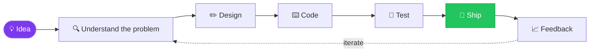
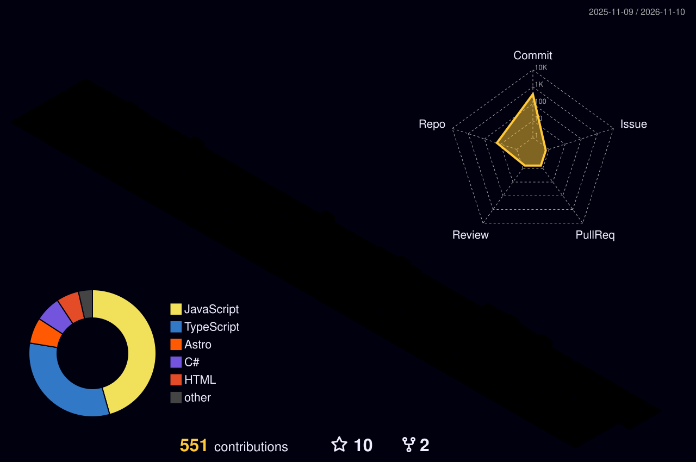

<!-- ================= HEADER ================= -->


<div align="center">

<a href="https://git.io/typing-svg">
  
</a>

<br/>

<a href="https://www.linkedin.com/in/kevin-lopes-151797221/"></a>
<a href="https://wa.me/5514997922151"></a>
<a href="mailto:kevinlopesdemorais@gmail.com"></a>


</div>

---

<!-- ================= TERMINAL ================= -->
<h2>🖥️ <code>~/kevin</code></h2>


<!-- ================= ABOUT AS CODE ================= -->
<h2>🧬 About me</h2>

```ts
const kevin = {
  role: "Full Stack Developer @ Moovefy",
  founder: "Kevma Tech — custom software & websites for small businesses",
  education: "Bachelor of Computer Science 🎓 · English B2 (exchange in Ireland 🇮🇪)",
  location: "Bauru-SP, Brazil 🇧🇷",
  backend: ["Node.js", "NestJS", "Express", "C# / .NET", "Python"],
  frontend: ["React", "React Native", "Next.js", "Angular", "Astro", "TypeScript"],
  data: ["PostgreSQL", "Oracle", "MySQL", "Supabase", "Prisma"],
  devops: ["Docker", "Kubernetes", "Vercel", "GitHub Actions"],
  ai: ["Gemini", "RAG", "AI agents in the delivery cycle"],
  automation: ["Playwright", "Electron", "scraping & bots"],
  mindset: "Learn → Build → Ship → Repeat",
  askMeAbout: ["APIs", "databases", "automation", "coffee ☕"],
};
```

<!-- ================= FEATURED PROJECTS ================= -->
<h2>🚀 Featured projects</h2>

<table>
  <tr>
    <td width="50%" valign="top">
      <a href="https://github.com/KevinLopes23/radar-revenda"></a>
      <h3><a href="https://github.com/KevinLopes23/radar-revenda">🏷️ Achadão</a></h3>
      Desktop app that scans Facebook Marketplace, OLX, Enjoei, Mercado Livre and Shopee, compares with market prices and scores resale deals 0–10.
      <br/><sub><b>Electron · React · TypeScript · Playwright · Gemini</b> · <a href="https://github.com/KevinLopes23/radar-revenda/releases/latest">⬇️ Download</a></sub>
    </td>
    <td width="50%" valign="top">
      <a href="https://revistaoj.com.br/"></a>
      <h3><a href="https://github.com/KevinLopes23/revista-OJ">💍 Revista OJ</a></h3>
      A printed jewelry magazine rebuilt as a ~5 KB-of-JS static site, with the issue's coloring card playable in the browser.
      <br/><sub><b>Astro · TypeScript · Canvas</b> · <a href="https://revistaoj.com.br/">🌐 Live</a></sub>
    </td>
  </tr>
  <tr>
    <td width="50%" valign="top">
      <a href="https://kevinlopes23.github.io/aurum-motors/"></a>
      <h3><a href="https://github.com/KevinLopes23/aurum-motors">🏎️ AURUM Motors</a></h3>
      Luxury car dealership showcase with native React 19 page transitions (ViewTransition) and a dark-and-gold identity.
      <br/><sub><b>Next.js 16 · React 19 · Tailwind v4 · Framer Motion</b> · <a href="https://kevinlopes23.github.io/aurum-motors/">🌐 Live</a></sub>
    </td>
    <td width="50%" valign="top">
      <a href="https://kevmatech.com.br/"></a>
      <h3><a href="https://github.com/KevinLopes23/kevmatech-site">🚀 Kevma Tech</a></h3>
      Website of my tech agency in Bauru: revenue calculator, quiz that leads to WhatsApp and local SEO — zero dependencies.
      <br/><sub><b>HTML · CSS · JavaScript · SEO</b> · <a href="https://kevmatech.com.br/">🌐 Live</a></sub>
    </td>
  </tr>
</table>

<details open>
<summary><b>⚙️ Backend, AI & automation</b></summary>
<br/>

| Project | What it does | Stack |
|---|---|---|
| [🔔 Team Task Manager](https://github.com/KevinLopes23/Sistema-de-Gest-o-de-Tarefas-com-Notifica-es) | Team tasks with real-time notifications, Clean Architecture and 61 tests (technical assessment) | .NET 8 · SignalR · React · PostgreSQL |
| [🤖 NLW Agents](https://github.com/KevinLopes23/NLW-Agents-Back) | Transcribes class audio and answers questions about it with RAG | Fastify · Drizzle · pgvector · Gemini |
| [🎯 Resume Adapter](https://github.com/KevinLopes23/adptador-curriculo) | CLI that tailors your resume to each job with AI — without inventing experience — and exports ATS-friendly PDFs | Node.js · TypeScript · Gemini |
| [🔎 LinkedIn Job Bot](https://github.com/KevinLopes23/linkedin-job-bot) | Hunts LinkedIn jobs every hour, filters the noise and sends the best ones to Telegram | Playwright · TypeScript · SQLite · Docker |
| [🧾 Invoice Control](https://github.com/KevinLopes23/Sistema-de-Controle-de-Faturas) | Invoice management with OCR | NestJS · React · Tesseract · Gemini |
| [🏨 HotelEvaluator](https://github.com/KevinLopes23/hotel_evaluator) | Aspect-based sentiment analysis of hotel reviews in Portuguese ([live demo](https://hotel-evaluator.onrender.com/)) | Python · Flask · spaCy |
| [✅ Task API](https://github.com/KevinLopes23/Sistema-de-Gerenciamento-de-Tarefas) | Team task API with roles, status history and Docker | Node.js · Express · Prisma · PostgreSQL |
| [🎲 Online Bingo](https://github.com/KevinLopes23/Bingo) | Multiplayer bingo in real time | Next.js · Prisma · Socket.IO |

</details>

<sub>👉 More in <a href="https://github.com/KevinLopes23?tab=repositories">all repositories</a>.</sub>

<!-- ================= HOW I WORK (Mermaid) ================= -->
<h2>🧠 How I build things</h2>



<!-- ================= STACK ================= -->
<h2>⚡ Tech stack</h2>

<div align="center">
  
</div>

<!-- ================= 3D CONTRIBUTIONS ================= -->
<h2>🌌 My contributions in 3D</h2>



<!-- ================= STATS ================= -->
<h2>📊 GitHub stats</h2>

<div align="center">

  <br/>
  
</div>

<details>
<summary><b>🏆 Click to see my trophies</b></summary>
<br/>
<div align="center">

</div>
</details>

<details>
<summary><b>🎲 Random dev quote</b></summary>
<br/>
<div align="center">

</div>
</details>

<!-- ================= SNAKE (auto light/dark) ================= -->
<h2>🐍 Eating my contributions</h2>

<picture>
  <source media="(prefers-color-scheme: dark)" srcset="https://raw.githubusercontent.com/KevinLopes23/KevinLopes23/output/snake-dark.svg" />
  <source media="(prefers-color-scheme: light)" srcset="https://raw.githubusercontent.com/KevinLopes23/KevinLopes23/output/snake.svg" />
  
</picture>

<!-- ================= FOOTER ================= -->

